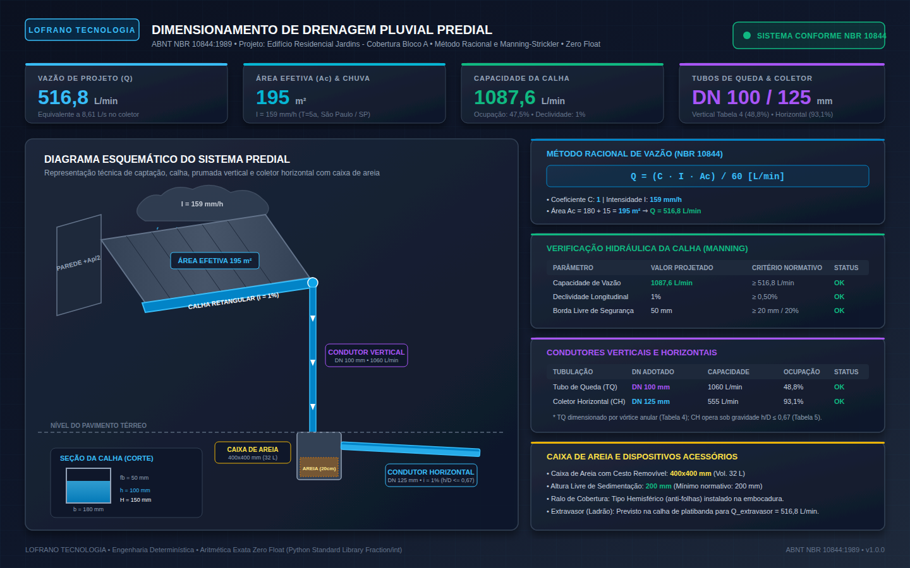

# Dimensionamento de Drenagem Pluvial Predial e Urbana (ABNT NBR 10844:1989)

[](https://github.com/martinlofranodeoliveira/dimensionamento-drenagem-pluvial-nbr10844/actions/workflows/ci.yml)
[](https://www.python.org/downloads/)
[](https://github.com/martinlofranodeoliveira/dimensionamento-drenagem-pluvial-nbr10844)
[](https://www.abnt.org.br/)
[](LICENSE)

Biblioteca e ferramenta CLI em **Python padrão puro** (Zero Dependências Externas) para dimensionamento hidráulico e verificação normativa de sistemas prediais e urbanos de drenagem de águas pluviais segundo a norma **ABNT NBR 10844:1989** (*Instalações prediais de águas pluviais - Procedimento*).

Desenvolvido sob o rigoroso padrão de engenharia **LOFRANO TECNOLOGIA**: aritmética **100% Zero Float** (todas as operações de vazão, área, declividade e Manning utilizam frações exatas `Fraction` e inteiros, eliminando imprecisões e erros de truncamento binário IEEE-754).

---



---

## 1. Destaques e Diferenciais

- **100% Python Padrão (Zero Dependências de Runtime)**: Executa com a biblioteca padrão do Python em qualquer sistema operacional (Linux, Windows, macOS).
- **Aritmética 100% Zero Float**: Cálculo exato de áreas, vazões, raízes quadradas e raízes cúbicas pelo método de Newton com inteiros/frações (`Fraction`), sem usar `float` em nenhuma etapa de dimensionamento.
- **Conformidade Integral com a ABNT NBR 10844:1989**:
  - **Chuva de Projeto**: Tabela oficial de intensidades pluviométricas $I$ (mm/h) para 20 capitais e polos brasileiros para durações de $t = 5\text{ min}$ e períodos de retorno $T \in \{1, 5, 25\}\text{ anos}$.
  - **Método Racional**: $Q = \frac{C \cdot I \cdot A_c}{60}\text{ (L/min)}$.
  - **Bacia de Contribuição Efetiva**: $A_c = A_h + \sum \frac{A_p}{2}$ considerando o vento-chuva sobre paredes verticais expostas.
  - **Calhas (Manning-Strickler)**: Dimensionamento de seções retangulares, semicirculares e trapezoidais, com checagem de velocidade, raio hidráulico, declividade mínima ($i \ge 0,5\%$) e borda livre de segurança ($f_b \ge 20\text{ mm}$ ou $20\%$).
  - **Condutores Verticais (Tubos de Queda)**: Verificação por escoamento com vórtice anular segundo a **Tabela 4 da NBR 10844** para bocais retos e com funil cônico.
  - **Condutores Horizontais (Coletores)**: Dimensionamento sob gravidade com lâmina d'água máxima de dois terços ($h/D \le 0,67$) e declividade mínima de $0,5\%$ conforme a **Tabela 5 da NBR 10844**.
  - **Dispositivos Acessórios**: Verificação de caixas de areia com câmara de sedimentação de sólidos ($h_{\text{sed}} \ge 200\text{ mm}$ e $400 \times 400\text{ mm}$ em planta), ralos hemisféricos anti-folhas e extravasores de emergência (ladrões).
- **Formatos de Saída Ricos**:
  - Relatório técnico estruturado em console e arquivo de texto (Memorial de Cálculo formatado em pt-BR).
  - Planilha técnica em **CSV com sanitização anti-injeção de fórmulas**.
  - Exportação em **JSON Canônico** (proibição de floats, chaves duplicadas e BOM UTF-8).
  - **Painel Vetorial SVG (1440x900)** com diagrama esquemático isométrico e tabelas normativas.

---

## 2. Formulação Matemática Normativa

### 2.1 Método Racional para Vazão de Projeto

A vazão de projeto $Q$ afluente a cada calha ou condutor é determinada pelo Método Racional:

$$Q = \frac{C \cdot I \cdot A_c}{60} \quad [\text{L/min}]$$

$$Q_s = \frac{Q}{60} = \frac{C \cdot I \cdot A_c}{3600} \quad [\text{L/s}]$$

onde:
- $C$ é o coeficiente de escoamento superficial (Runoff, adimensional, ex: $1,0$ para telhados e lajes impermeabilizadas; $0,85$ para asfalto; $0,25$ para gramados);
- $I$ é a intensidade pluviométrica de cálculo em $\text{mm/h}$ para a localidade e período de retorno $T$;
- $A_c$ é a área de contribuição efetiva em $\text{m}^2$.

### 2.2 Área de Contribuição Efetiva ($A_c$)

De acordo com o item 5.1.2 da NBR 10844, quando houver paredes verticais contíguas à cobertura que recebam precipitação e vento direcionando água para a calha:

$$A_c = A_h + \sum \frac{A_{\text{parede}}}{2}$$

onde:
- $A_h$ é a área da cobertura em projeção horizontal ($\text{m}^2$);
- $A_{\text{parede}}$ é a área da superfície vertical exposta ($\text{m}^2$).

### 2.3 Dimensionamento de Calhas (Manning-Strickler)

A capacidade de escoamento em regime uniforme permanente para calhas é dada pela fórmula de Manning-Strickler:

$$Q_{\text{calha}} = \frac{60\,000}{n} \cdot S \cdot R_h^{2/3} \cdot i^{1/2} \quad [\text{L/min}]$$

$$v = \frac{1}{n} \cdot R_h^{2/3} \cdot i^{1/2} \quad [\text{m/s}]$$

onde:
- $S$ é a área molhada da seção transversal ($\text{m}^2$);
- $P$ é o perímetro molhado da seção ($\text{m}$);
- $R_h = S / P$ é o raio hidráulico ($\text{m}$);
- $i$ é a declividade longitudinal da calha ($\text{m/m}$), sendo exigido $i \ge 0,005$ ($0,5\%$);
- $n$ é o coeficiente de rugosidade de Manning ($\text{s/m}^{1/3}$), sendo $n = 0,011$ para PVC e $n = 0,013$ para chapa de aço galvanizado.

O cálculo exato de $R_h^{2/3} = \sqrt[3]{R_h^2}$ e $i^{1/2} = \sqrt{i}$ é realizado por algoritmos determinísticos de aproximação racional em frações com precisão garantida de 12 casas decimais.

### 2.4 Condutores Verticais (Tubos de Queda - Tabela 4 NBR 10844)

Capacidades máximas admissíveis de escoamento livre com vórtice anular:

| DN (mm) | Bocal Reto Cilíndrico (L/min) | Bocal com Funil Cônico (L/min) |
|:-------:|:-----------------------------:|:------------------------------:|
| **75**  | 270                           | 470                            |
| **100** | 540                           | 1.060                          |
| **125** | 950                           | 1.950                          |
| **150** | 1.500                         | 3.250                          |
| **200** | 3.000                         | 7.000                          |

### 2.5 Condutores Horizontais (Coletores - Tabela 5 NBR 10844)

Tubos de PVC ($n = 0,011$) operando sob gravidade com lâmina máxima d'água de $h/D \le 0,67$ (dois terços do diâmetro):

| DN (mm) | i = 0,5% (L/min) | i = 1,0% (L/min) | i = 1,5% (L/min) | i = 2,0% (L/min) | i = 3,0% (L/min) | i = 4,0% (L/min) |
|:-------:|:----------------:|:----------------:|:----------------:|:----------------:|:----------------:|:----------------:|
| **75**  | 95               | 135              | 165              | 190              | 235              | 270              |
| **100** | 215              | 305              | 375              | 435              | 535              | 615              |
| **125** | 390              | 555              | 680              | 785              | 965              | 1.115            |
| **150** | 640              | 905              | 1.110            | 1.285            | 1.575            | 1.820            |
| **200** | 1.365            | 1.935            | 2.370            | 2.735            | 3.350            | 3.870            |
| **250** | 2.450            | 3.470            | 4.250            | 4.910            | 6.010            | 6.940            |
| **300** | 3.950            | 5.590            | 6.850            | 7.910            | 9.680            | 11.180           |

---

## 3. Instalação

Como o pacote não possui dependências externas de terceiros, sua instalação e execução são imediatas:

```bash
git clone https://github.com/martinlofranodeoliveira/dimensionamento-drenagem-pluvial-nbr10844.git
cd dimensionamento-drenagem-pluvial-nbr10844
pip install .
```

Ou simplesmente adicione `src/` ao seu `PYTHONPATH`.

---

## 4. Uso via Linha de Comando (CLI)

O executável CLI `drenagem-pluvial` está disponível no ambiente:

### 4.1 Dimensionar a partir de Arquivo JSON

```bash
drenagem-pluvial dimensionar --arquivo examples/edificio_residencial.json \
  --saida-json resultado.json \
  --saida-csv resultado.csv \
  --saida-relatorio memorial.txt \
  --painel-svg painel.svg
```

### 4.2 Dimensionar Diretamente por Argumentos de Linha de Comando

```bash
drenagem-pluvial dimensionar \
  --cidade sao_paulo \
  --retorno 5 \
  --area 220 \
  --parede-altura 2.5 \
  --parede-largura 10.0 \
  --calha-largura 200 \
  --calha-altura 150 \
  --calha-declividade 1.0 \
  --tq-dn 100 \
  --tq-bocal funil \
  --ch-dn 125 \
  --ch-declividade 1.0
```

### 4.3 Consultar Chuvas das Cidades Brasileiras (Tabela NBR 10844)

```bash
drenagem-pluvial cidades
```

### 4.4 Consultar Tabelas Normativas 4 e 5

```bash
drenagem-pluvial tabelas
```

---

## 5. Uso como Biblioteca Python

```python
from fractions import Fraction
from drenagem_pluvial_nbr10844 import (
    ProjetoDrenagem,
    DadosChuva,
    SuperficieContribuicao,
    ParedeVertical,
    Calha,
    CondutorVertical,
    CondutorHorizontal,
    CaixaAreia,
    dimensionar_sistema,
    exportar_csv,
    gerar_painel_svg,
)

# 1. Definição do Projeto
projeto = ProjetoDrenagem(
    identificacao="Residência Alphaville",
    chuva=DadosChuva(
        cidade="São Paulo",
        uf="SP",
        periodo_retorno_anos=5,
        duracao_minutos=5,
        intensidade_mm_h=Fraction(159, 1),
    ),
    superficie=SuperficieContribuicao(
        identificacao="Telhado Cerâmico",
        area_horizontal_m2=Fraction(180, 1),
        coeficiente_escoamento=Fraction(1, 1),
        paredes=[ParedeVertical("Platibanda", Fraction(25, 10), Fraction(12, 1))],
    ),
    calha=Calha(
        identificacao="Calha Perimetral",
        tipo_secao="retangular",
        material="aco_galvanizado",
        largura_fundo_mm=Fraction(180, 1),
        altura_total_mm=Fraction(150, 1),
        declividade_m_m=Fraction(1, 100), # 1,0%
    ),
    condutor_vertical=CondutorVertical("TQ-01", dn_mm=100, tipo_bocal="funil"),
    condutor_horizontal=CondutorHorizontal("CH-01", dn_mm=125, declividade_m_m=Fraction(1, 100)),
    caixa_areia=CaixaAreia("CA-01", 400, 400, 400, 200),
)

# 2. Execução do Dimensionamento
resultado = dimensionar_sistema(projeto)

print(f"Status Geral: {'APROVADO' if resultado.atende_geral else 'NÃO CONFORME'}")
print(f"Vazão de Projeto: {resultado.resultado_superficie.vazao_projeto_L_min} L/min")
print(f"Capacidade da Calha: {resultado.resultado_calha.vazao_admissivel_L_min} L/min")

# 3. Exportações
csv_planilha = exportar_csv(resultado)
svg_painel = gerar_painel_svg(resultado)
```

---

## 6. Qualidade, Testes e Verificação Independente

O projeto conta com mais de 55 testes unitários automatizados cobrindo todos os módulos e um **verificador independente** construído exclusivamente com SQLite em memória (`tools/verify_independent.py`):

```bash
# Execução dos Testes Unitários
python3 -m unittest discover -s tests -p "test_*.py" -v

# Execução do Verificador Independente em SQLite
python3 tools/verify_independent.py

# Teste com Isolamento Estrito de Rede
unshare -r -n python3 -m unittest discover -s tests -p "test_*.py"
```

A esteira de Integração Contínua (CI) valida cada alteração em ambientes Ubuntu (Python 3.11, 3.12, 3.13, 3.14) e Windows (Python 3.14).

---

## 7. Licença

Este software é licenciado sob a [Licença MIT](LICENSE).

Copyright (c) 2026 **LOFRANO TECNOLOGIA / Martin Lofrano de Oliveira**.
